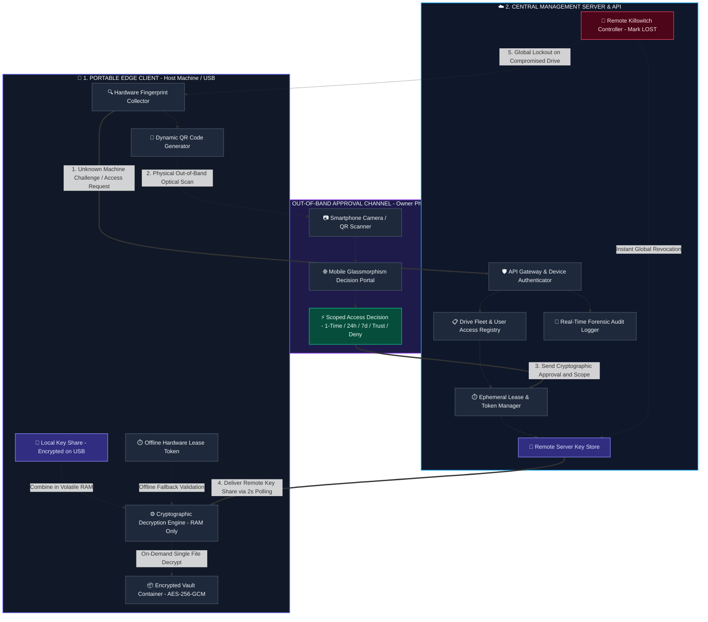

# 🛡️ USB Killswitch v2 — Zero-Trust Encrypted Storage

> **Remote-Killable Encrypted USB Storage with Split-Key Cryptography, Tail-Manifest Vaults, Out-of-Band Mobile Approvals, and Offline Hardware Leases.**

[](LICENSE)
[](https://www.python.org/)
[](https://nodejs.org/)
[]()
[]()

---

## 📌 Executive Summary

Traditional hardware encryption (BitLocker To Go, VeraCrypt, static password USBs) suffers from a fundamental security flaw: **once an encrypted drive is lost or stolen, physical possession guarantees an offline brute-force attack vector, with zero remote revocation capability.**

**USB Killswitch** eliminates this physical possession threat by enforcing a **Zero-Trust Split-Key Model**:
1. **The Master Key is Split**: Half is stored in an encrypted local share on the USB drive, and the other half is retained securely on a cloud management server.
2. **Out-of-Band 2FA Approval**: When connected to an unrecognized machine, the client halts in a zero-trust holding pattern until the drive owner grants approval via a smartphone QR scan or web portal.
3. **Emergency Remote Killswitch**: Administrators can mark any drive as `LOST` with a single click, instantly cutting off key distribution worldwide and rendering the drive cryptographically unreadable.
4. **On-Demand Single-File Access**: Files are decrypted selectively into volatile memory only when opened, avoiding full-disk exposure and leaving zero residual trace upon locking.

---

## 🏗️ System Architecture



---

## ✨ Core Features

| Feature | Description |
|---|---|
| **Split-Key AES-256-GCM** | Military-grade authenticated encryption where the master key is divided between local drive storage and cloud backend. |
| **Zero-Config Cloud Pre-integration** | Pre-configured to communicate with the cloud management gateway out-of-the-box, without requiring manual server URL setup. |
| **Out-of-Band Mobile 2FA** | Real-time QR code display on the desktop client that can be scanned by the owner’s smartphone to approve or deny access. |
| **Instant Remote Killswitch** | One-click emergency lockout from the web dashboard that immediately revokes key delivery worldwide. |
| **Hardware Fingerprint Binding** | Binds sessions to unique CPU, motherboard, and disk signatures to prevent token cloning. |
| **Offline Time-Bounded Leases** | Digitally signed cryptographic tokens allow working offline (e.g., in-flight) for defined periods without active internet. |
| **Encapsulated 2-File Architecture** | Prepend the local key (`K_local`), configuration, and lease token into an authenticated 4 KB header inside `vault.enc` — exactly 2 files exist on the USB: `Zero-Trust.exe` and `vault.enc`. |
| **Tail-Manifest Vault Format** | Single-file encrypted container (`vault.enc`) with tamper-proof authenticated file manifests. |
| **Single-File On-Demand Decrypt** | Decrypts only the specific file opened into a temporary RAM workspace, re-encrypts changes, and securely shreds cache upon locking. |
| **Central Admin Dashboard** | Full web UI for managing drive fleets, access control lists (ACLs), approval queues, and immutable forensic audit logs. |

---

## 📂 Project Structure

```text
Storage Protection/
├── backend/                        # Node.js Express Server & Web Portals
│   ├── server.js                   # API routes, auth engine, session manager, & SQLite store
│   ├── package.json                # Server dependencies
│   └── public/
│       ├── index.html              # Admin & Fleet Management Web Dashboard
│       └── approve.html            # Mobile Glassmorphism Device Approval Portal
├── usb_client/                     # Python Desktop Client
│   ├── gui.py                      # CustomTkinter modern dark-mode Desktop GUI
│   ├── crypto_engine.py            # Tail-Manifest AES-256-GCM Cryptographic Engine
│   ├── fingerprint.py              # Hardware identification & device fingerprinting
│   ├── lease_manager.py            # Offline signed lease validator & storage
│   └── requirements.txt            # Python client dependencies
├── dist/
│   └── USB_Killswitch.exe          # Standalone, single-file compiled portable executable
├── QUICKSTART.md                   # Comprehensive deployment & usage guide
└── README.md                       # Main project documentation
```

---

## 🚀 Quick Start Guide

### 1. Start the Backend Management Server

```bash
cd backend
npm install
npm start
```
* The server will start on `http://localhost:3000`.
* **Admin Dashboard**: `http://localhost:3000/dashboard`
* **Mobile Approval Portal**: `http://localhost:3000/approve`

---

### 2. Launch the Desktop Client

#### Option A: Run the Standalone Portable Executable (Recommended)
Copy `dist/USB_Killswitch.exe` directly onto your USB drive and double-click to launch.

#### Option B: Run from Source
```bash
# Install Python dependencies
pip install -r usb_client/requirements.txt

# Launch Desktop GUI
python usb_client/gui.py
```

---

## 🔄 End-to-End Operational Workflow

### Step 1: Initialize & Encrypt a Drive
1. Launch the Desktop Client.
2. Sign in with **"Continue with Google"** or enter the **Owner Email** (e.g., `owner@gmail.com`).
3. Select the folder to protect and click **`🚀 Initialize & Encrypt Drive`**.
4. The client creates the encapsulated `vault.enc` container (packing configuration and local key share directly into the encrypted header) and registers the drive fingerprint with the backend automatically. No loose metadata files are written to the USB drive.

### Step 2: Unlocking on a Trusted Machine
* On recognized hardware with an active lease, clicking **`Unlock Vault`** grants instant access without approval prompts.

### Step 3: Unlocking on an Unrecognized Machine (Guest / Unknown PC)
1. When launched on a new computer, the client enters a waiting state and displays:
   - **QR Code** for smartphone camera scanning.
   - **Continue with Google** for browser-based identity verification.
2. The owner scans the QR code or opens the dashboard, choosing an access duration:
   - `⚡ Approve 1-Time (12 Hours)`
   - `⏱️ Approve 24h Lease`
   - `📅 Approve 7-Day Lease`
   - `♾️ Trust Permanently`
   - `🚫 Deny Access`
3. Within 2 seconds of approval, the desktop client receives the key share and unlocks automatically.

### Step 4: Vault File Workspace
* **Open File**: Double-click any file to decrypt and view it on-the-fly.
* **Edit in Explorer**: Open the temporary session folder to add or edit files.
* **Lock & Save**: Re-encrypts modified files back into the vault and securely shreds temporary disk cache.

### Step 5: Emergency Remote Killswitch
* If a drive is lost or stolen, open the Web Dashboard and click **🔴 Mark LOST**.
* The server immediately revokes all leases and blocks key retrieval, rendering the drive permanently unreadable.
* Clicking **🟢 Reactivate** restores access once the drive is safely recovered.

---

## 🧪 Testing & Verification

Run automated test suites to verify end-to-end functionality:

```bash
# 1. Multi-USB Simulation (All user & approval scenarios)
node test_multi_usb_scenarios.js

# 2. Cryptographic Engine & Offline Vault Lifecycle
python test_multi_usb_crypto.py

# 3. Edge Cases & Concurrency Verification
node test_all_advanced_scenarios.js
```

---

## 🔒 Security & Cryptography Details

* **Cipher Suite**: AES-256-GCM (Authenticated Galois/Counter Mode with 96-bit nonce and 128-bit authentication tag).
* **Key Derivation**: HKDF-SHA256 with cryptographically random salts.
* **Integrity Guarantee**: Tamper-proof tail-manifest containing per-file SHA-256 integrity hashes.
* **Zero Residual Footprint**: Volatile memory key assembly; automated multi-pass file shredding upon locking.

---

## 📄 License

This project is licensed under the [MIT License](LICENSE).
